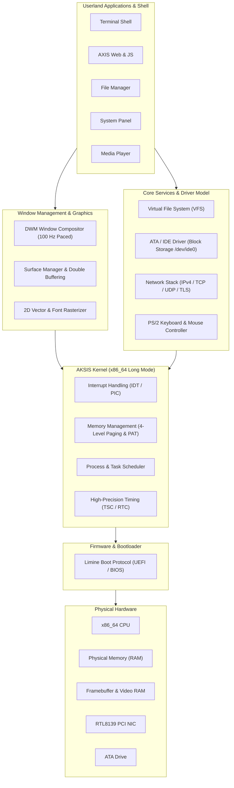
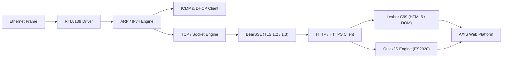

<div align="center">

# AKSIS OS

### A 64-bit x86 Operating System and Desktop Environment

[](#system-architecture)
[](#boot-and-firmware-interface)
[](#graphics-and-window-composition)
[](#network-stack-and-web-runtime)
[](LICENSE)

<br/>

AKSIS OS is an independent operating system and desktop environment developed from scratch in C and x86_64 assembly. Designed for the 64-bit x86 architecture, it boots across UEFI and legacy BIOS systems via the Limine protocol, featuring an integrated retained-mode window compositor, virtual filesystem with ATA persistence, hardware-driven TCP/IP networking, and an in-kernel web runtime.

[Overview](#overview) • [System Architecture](#system-architecture) • [Kernel Subsystems](#kernel-subsystems) • [Graphics and Composition](#graphics-and-window-composition) • [Network Stack and Web Runtime](#network-stack-and-web-runtime) • [Building and Running](#building-and-running) • [Directory Layout](#directory-layout) • [License](#license)

</div>

---

## Overview

AKSIS OS is designed around clean hardware abstraction, low-latency display composition, and modular kernel service separation without reliance on external monolithic POSIX runtimes. It provides a complete freestanding operating environment: booting directly into a 1080p double-buffered graphical desktop, managing isolated window surfaces, routing network packets through a native TCP/IP stack, and evaluating client-side DOM and JavaScript workloads natively.

Primary design goals include:
- A freestanding 64-bit Long Mode kernel with strict separation between physical memory management and paging layers.
- High-throughput graphics pipelines leveraging Page Attribute Table (PAT) write-combining and dirty-region pacing.
- Self-contained networking and cryptographic primitives capable of establishing secure TLS connections directly from kernel space.
- A standards-compliant DOM parser and JavaScript execution engine embedded directly into userland services.

---

## System Architecture

The operating system follows a layered architecture where user-facing applications interface with hardware through structured driver abstractions and an asynchronous display composition subsystem.



---

## Kernel Subsystems

### Memory Management and Paging
- **64-bit Long Mode Initialization:** Boots with flat physical addressing, sets up an isolated 4-level paging structure, and handles interrupt dispatching through a dedicated Interrupt Descriptor Table (IDT).
- **Page Attribute Table (PAT):** Configures Write-Combining caching policies over physical video memory mappings. This reduces memory bus contention and eliminates tearing during 1080p framebuffer blits.
- **Dynamic Allocation:** Features an early bump allocator for stage-one initialization, transitioning into a tracked heap allocator with memory validation.

### Virtual File System and Storage
- **VFS Architecture:** Implements a Unix-style node and directory hierarchy supporting standard file permission octets (owner, group, other flags).
- **Block Driver and Persistence:** An integrated ATA/IDE driver operating in PIO mode mounts `/dev/ide0`. Filesystem mutations persist directly to physical block storage.
- **Pseudo Filesystems:** Exposes runtime status nodes including `/sys/uptime`, `/sys/meminfo`, and transient memory storage under `/tmp`.

### Timing and Execution
- **TSC Calibration:** Hardware TSC (Time Stamp Counter) measures operational frequency at boot.
- **Real-Time Clock:** Real-time fallback synchronized against the motherboard RTC provides UTC date and wall-clock time preservation.

---

## Graphics and Window Composition

The desktop interface operates as a native composited environment built upon a Desktop Window Manager (DWM) architecture.

- **Retained Surface Model:** Applications render into dedicated double-buffered off-screen memory surfaces. The compositor performs dirty-region calculation, alpha blending, and clipped updates.
- **Frame Pacing:** Render passes are capped at 100 Hz to prevent CPU starvation while maintaining sub-frame interactive latency.
- **Typography and Rasterization:**
  - High-legibility anti-aliased bitmap fonts derived from Selawik and Noto Sans Mono.
  - Subpixel anti-aliased 4x4 coverage sampling for cursors and window frames.
  - Procedural vector rendering for icons and interface controls.
- **Input Handling:** Complete PS/2 keyboard processing with full UTF-8 character encoding and mouse packet normalization.

---

## Network Stack and Web Runtime

AKSIS OS includes an in-tree network stack and an embedded HTML/JS execution environment designed to operate without host dependencies.



| Component | Implementation | Responsibility |
|---|---|---|
| **NIC Driver** | Realtek RTL8139 (PCI) | Hardware packet TX/RX and ring buffer management |
| **Network Protocols** | ARP, IPv4, ICMP, DHCP | Packet routing, address resolution, dynamic lease acquisition |
| **Transport Layer** | TCP, UDP | Connection state machines, window scaling, reliable transport |
| **Cryptography** | BearSSL 0.6 | TLS 1.2/1.3 handshakes, cipher suites, X.509 certificate validation |
| **HTML Parser** | Lexbor (Pure C99) | Standards-compliant HTML5 parsing, CSS cascade, DOM tree construction |
| **JavaScript Engine** | QuickJS | Full ES2020 specification support, DOM event bindings, microtask queue |
| **Secure Shell** | Embedded SSH-2.0 | Remote administrative shell and authentication subsystem |

---

## Building and Running

### Prerequisites

Compilation requires standard cross-development tools targeting freestanding x86_64 ELF:

- `gcc` or `clang`
- `nasm` (Assembler)
- `make`
- `xorriso` and `mtools` (ISO9660 and FAT image manipulation)
- `qemu-system-x86_64` (Hardware emulation)

#### macOS (Homebrew)
```bash
brew install nasm qemu xorriso mtools
```

#### Debian / Ubuntu
```bash
sudo apt-get install build-essential nasm qemu-system-x86 xorriso mtools
```

### Build Instructions

1. Clone the repository and initialize submodules:
   ```bash
   git clone --recurse-submodules https://github.com/aliyabuz25/AKSIS-OS.git
   cd AKSIS-OS
   ```

2. Compile the kernel and generate the hybrid bootable ISO image:
   ```bash
   make iso
   ```
   *The target image will be generated at `build/out/shenlong.iso`.*

3. Launch within QEMU:
   ```bash
   # BIOS boot
   make run

   # UEFI boot
   make run-uefi
   ```

4. Execute validation test suites:
   ```bash
   make test
   ```

---

## Directory Layout

```
AKSIS-OS/
├── assets/          # Interface templates, fonts, boot logos, and media assets
├── bootloader/      # MBR stage1, stage2, and CD-ROM boot assembly routines
├── build/           # Limine configuration, linker scripts, and build harness
├── docs/            # Architecture specifications and technical references
├── kernel/          # Core operating system source code
│   ├── axis_web/    # Lexbor and QuickJS runtime integration bindings
│   └── libc/        # Freestanding C runtime header stubs
├── limine/          # Limine bootloader UEFI and BIOS binaries
├── shell/           # Userland command-line interface implementation
├── tools/           # Asset compressors, font builders, and VM packaging scripts
└── vendor/          # In-tree vendor libraries (BearSSL, Lexbor, QuickJS, stb)
```

---

## License

This project is licensed under the [GNU General Public License v3.0](LICENSE). Refer to the `LICENSE` file for the full terms and conditions.
EOF